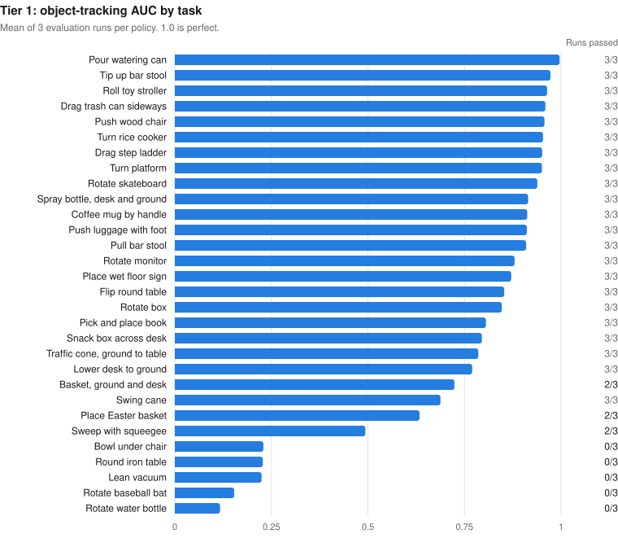

# V2D Track 2: human motion to humanoid robot policies

This project trains a simulated Unitree G1 humanoid to copy how people handle everyday objects: drag a trash can, flip a table, pour a watering can. Each recorded human motion is converted to the robot's body, then one reinforcement learning policy is trained to carry it out in physics simulation.

It uses the Track 2 task from NVIDIA's [Video-to-Data Challenge](https://nvidia-isaac.github.io/video_to_data/v2d_challenge/) (CoRL 2026). I built it independently and **did not submit it**, so every score here comes from my own runs of the challenge evaluator. It is not affiliated with NVIDIA.

<picture>
  <source media="(prefers-color-scheme: dark)" srcset="assets/tier1-dark.svg">
  
</picture>

A run passes if the object's average error over the motion is at most 10 cm and 0.5 rad (29°). Per-task numbers: [tier1_results.csv](docs/tier1_results.csv).

## Results

The challenge has three tiers of 30 motions each, with progressively worse input.

| Tier | Input | Result |
|---|---|---|
| 1 | Clean multi-camera capture | 22 of 30 policies pass all 3 runs, 3 pass 2 of 3, 5 fail. Mean AUC 0.746 |
| 2 | Motion with synthetic noise | 30 policies trained. Judged by the worst of 3 runs against their own noisy input, 4 pass, 10 miss on orientation only and 16 fail on position |
| 3 | Single-camera video | All 30 motions reconstructed, but none cleared my checks. Pilot policies for one motion failed |

On Tier 1, 72 of 90 runs pass at 10 cm, and 69 of 90 at a tighter 3 cm and 30°. The median pose error is 1.3 cm. The mean is 11.5 cm, mostly because the two worst policies are off by about a meter. The best AUC on the challenge's public Tier 1 board was 0.949.

## How it works

1. **Convert.** Read the released recording: human pose, object pose, object mesh and scene.
2. **Retarget.** Map the human motion to the G1 and its Dex3 hands.
3. **Train.** One policy per motion, rewarded for tracking the robot and object reference. 350M simulation steps for Tier 1, 50M for Tier 2.
4. **Evaluate.** Run each policy 3 times and report the mean, with the rule for choosing a checkpoint fixed in advance.

Retargeting, the simulator environment and the training algorithm (FlashSAC) come from NVIDIA's [video_to_data](https://github.com/nvidia-isaac/video_to_data) at commit `7eb9721`. What I added:

- **Data conversion** from the released recordings into retargeter input, and checks that reject broken references before training.
- **Contact labels for noisy motion.** Upstream marks a hand as touching when it is within 2 cm of the object, which noise breaks. My version adapts to each recording. On clean examples that I corrupted myself, mean F1 rose from 0.79 to 0.87, and from 0.49 to 0.82 at the highest noise. At the two lowest noise levels, upstream's rule is better.
- **A runner for rented GPUs** with spending caps, a watchdog that shuts down abandoned machines, and hash-checked backups before a normal shutdown. Total spend on Vast.ai was about $127. A Tier 1 policy cost about $2 to train.
- **A Tier 3 pipeline** that runs NVIDIA's video reconstruction (CARI4D) over all 30 motions and checks the results for motion quality and object contact.

## What didn't work

- **Tier 2:** policies inherit the noise in their input.
- **Tier 3:** reconstruction from one camera never cleared my checks, partly on motion quality and partly because I never confirmed that the released object meshes were allowed.
- **Evaluation isn't fully repeatable.** In one case, reloading the same checkpoint dropped AUC from 0.84 to 0.07.
- **Tier 1 scores are slightly optimistic.** Each is the better of two checkpoints, judged on the same 3 runs that are reported.
- **Submission:** I left those steps too late and missed the deadline.

## Code

| Path | Contents |
|---|---|
| `scripts/` | Conversion, contact labels, training, evaluation |
| `scripts/vast/` | Rented GPU launch, watchdog and backup |
| `scripts/tier3_native/` | Video reconstruction |
| `patches/` | Changes to upstream code |
| `data/` | Frozen job lists, plans and decision rules |
| `tests/` | Test suite |
| `docs/` | [Script reference and commands](docs/pipeline.md), [Tier 3 notes](docs/tier3.md), [train and evaluate contract](docs/downstream_contract.md) |

Training needs Linux and an NVIDIA GPU with at least 46 GB of free memory. `scripts/gpu_bootstrap.sh` sets up a machine and downloads the challenge data. Trained policies and data are not included, so many tests can't run from a fresh clone.

## License

[Apache-2.0](LICENSE). Third-party data and models keep their own terms: see [THIRD_PARTY_NOTICES.md](THIRD_PARTY_NOTICES.md).
